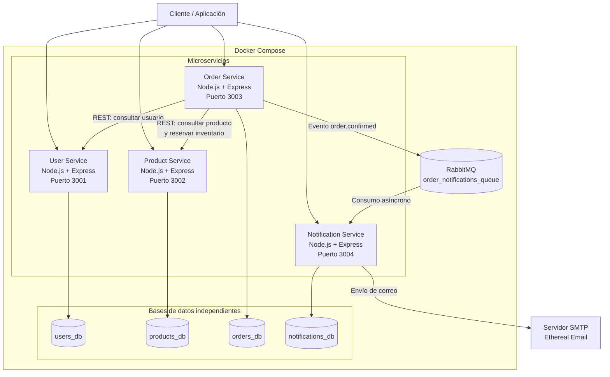

# Diagrama de arquitectura de microservicios

## Arquitectura general

## Descripción

La arquitectura implementada está compuesta por cuatro microservicios independientes, cada uno con responsabilidades específicas y su propia base de datos PostgreSQL. La comunicación entre los servicios se realiza mediante API REST para las operaciones síncronas y RabbitMQ para el intercambio asíncrono de eventos.

El microservicio de pedidos se comunica con los servicios de usuarios y productos para validar la información necesaria durante la creación y confirmación de pedidos. Una vez confirmado un pedido, publica un evento en RabbitMQ que es consumido por el microservicio de notificaciones, encargado de registrar la notificación y gestionar el envío del correo electrónico mediante Nodemailer y un servidor SMTP.

Los componentes se ejecutan mediante Docker Compose, lo que permite centralizar su configuración, construcción y despliegue.
